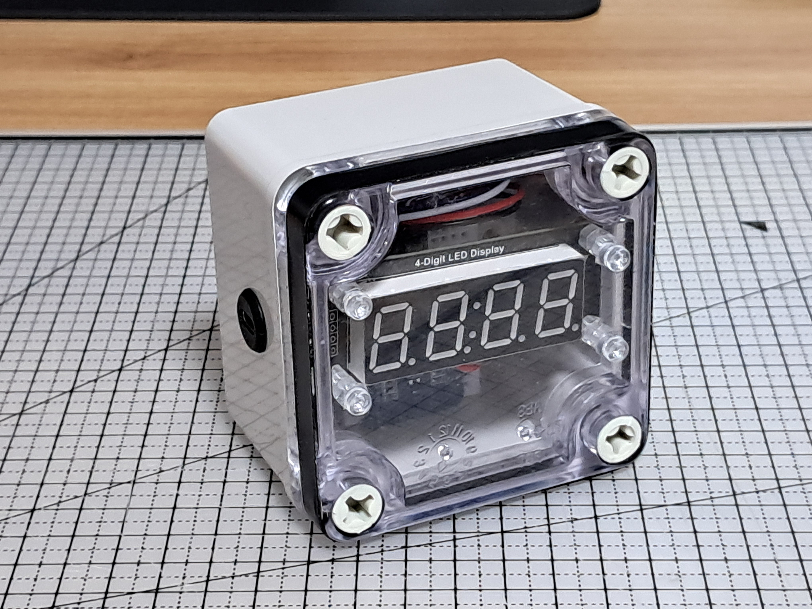
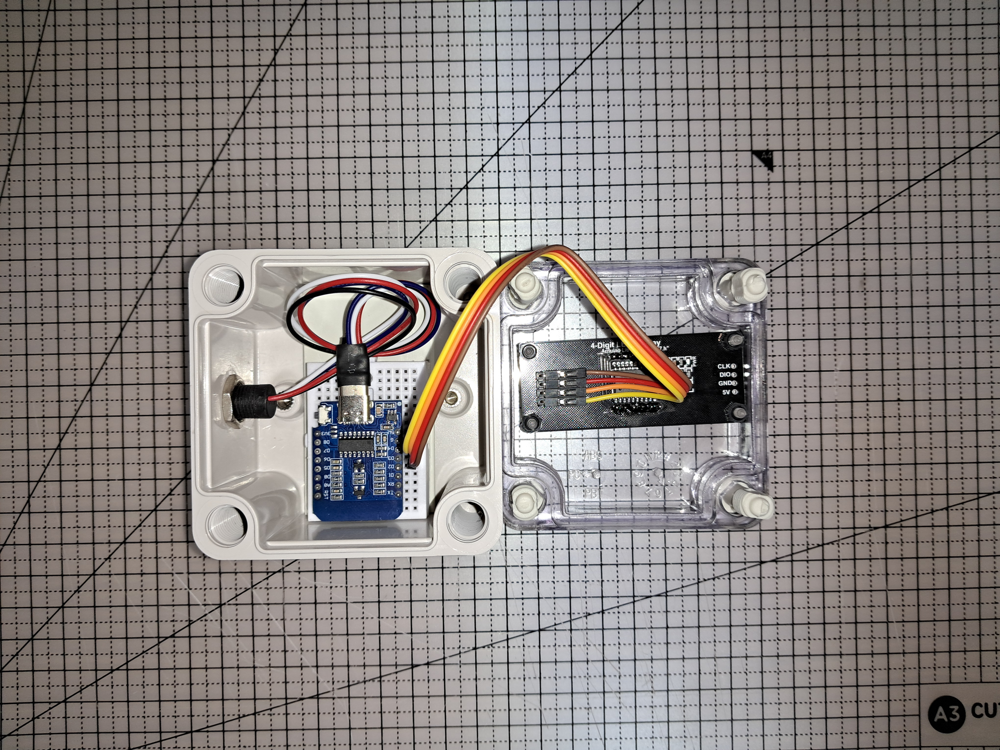
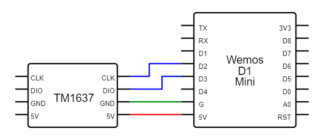
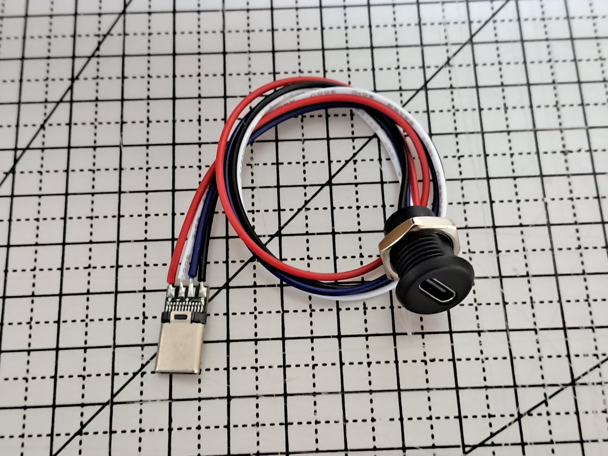

## 프로젝트 개요

<table>
  <tr>
    <td>
      
    </td>
    <td>
      
    </td>
  </tr>
</table>

Wemos D1 Mini 보드에서 NTP 서버의 시간을 수신하여 TM-1637 디스플레이에 표시한다.

## 개발 배경

**2024년 7월.** 아날로그 벽시계 돌아가는 소리가 거슬려서 다이소에서 구입한 탁상 전자시계를 사용하게 되었다. 그런데 다이소 전자시계는 조용해서 좋기는 하지만 잊을만하면 한 번씩 오차가 생겨서 핸드폰을 보고 맞춰야 하는 문제가 있었다. 

나는 비록 취업에는 실패했지만 웹개발 국비훈련을 수료했고, 전기기술도 배웠다. 둘을 결합하면 이 불편함을 해결할 뭔가를 만들어낼 수 있을 것 같았다. 

처음에는 의존성을 최소화하고 싶었기 때문에 와이파이가 아닌 다른 통신 방법을 시도했다. 

먼저 시도한 것은 GPS 신호에 포함된 시간정보를 이용하는 것이었다. 아두이노에 널리 쓰이는 NEO-6M GPS 모듈을 사용했다. 하지만 창문을 열고 창가에 바짝 붙여놓지 않으면 동작하지 않았다.

그런데 언젠가 고급 손목시계는 라디오 신호를 수신해서 시각을 보정한다고 들었던 게 생각이 났다. DCF77 라디오 모듈을 사용해서 일본 표준시보국(JJY)의 장파 60khz 대역 시보방송을 수신해봤다. 하지만 GPS와 마찬가지로 창가에서 창문을 열어놓았을 때만 동작했기 때문에 탁상시계라는 목적과는 맞지 않았다. 

결국 와이파이를 사용하기로 하고 ESP8266이 내장된 Wemos D1 Mini 보드를 선택했다.

## 결선도

## 동작 설명

https://github.com/user-attachments/assets/23bcee39-a3a5-4792-965c-6e132f399a57

1) 전원을 켜면 화면에 Connect를 뜻하는 Conn이라는 글자가 표시되고 와이파이 접속을 시도한다

2) 와이파이 접속이 성공하면 NTP 클라이언트를 실행하고 시간 출력을 시작한다

3) 가운데 콜론을 0.5초마다 점멸시켜야 하므로 여기에 맞춰서 화면이 0.5초마다 갱신된다

## 전원 공급 방법

Wemos D1 Mini 보드에는 아두이노와 달리 Vin 단자가 없다. 5V나 3.3V 단자로 전원을 공급할 수는 있지만 레귤레이터가 안 달려있어서 별로 좋은 선택은 아닌 듯했다. 그래서 USB C타입 소켓과 플러그를 납땜해서 내부 전원 케이블을 만들었다. 4핀이라 데이터 전송도 되기 때문에 조립된 상태에서도 코드를 수정할 수 있다는 장점도 있다.
